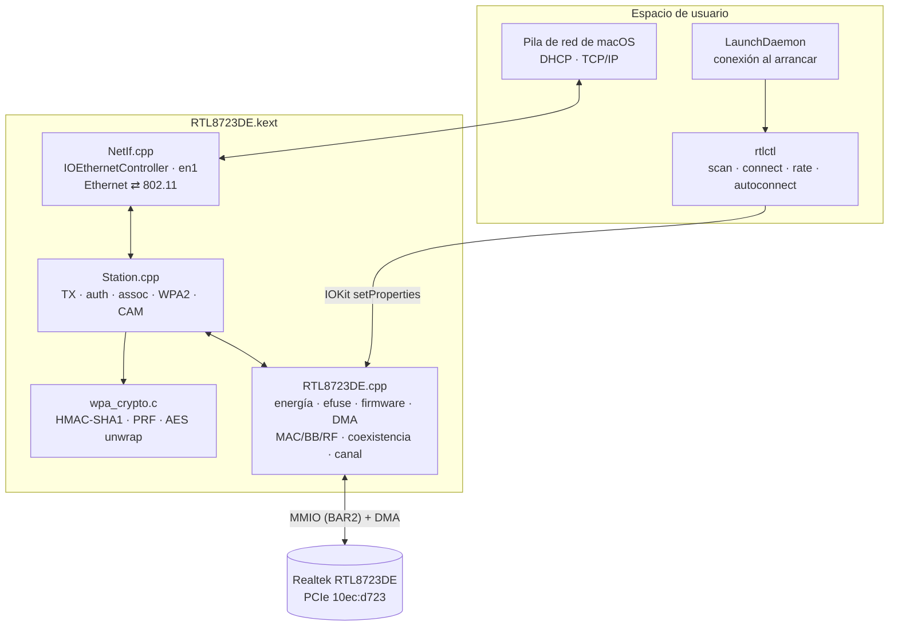

<div align="center">

# RTL8723DE para macOS

**Un driver Wi-Fi escrito desde cero para darle una segunda vida a una laptop HP con Hackintosh**


</div>

---

La tarjeta Wi-Fi **Realtek RTL8723DE** (`10ec:d723`) que traen muchas laptops económicas no tiene driver para macOS. Este proyecto es un kext que la hace funcionar: porta a macOS las partes necesarias del driver `rtw88` de Linux e implementa encima el modo estación, WPA2-PSK y una interfaz de red.

Se desarrolló y probó en una **HP 240 G6** (Core i5-8250U) con macOS 15.8.2 y OpenCore 1.0.9.

> [!WARNING]
> Es un driver de **kernel** experimental. Puede provocar kernel panics. Úsalo solo si sabes recuperar tu EFI de OpenCore desde un USB y ten siempre una copia de seguridad.

## Tabla de contenidos

- [Qué funciona](#qué-funciona)
- [Resultados](#resultados)
- [Cómo funciona](#cómo-funciona)
- [Hitos del desarrollo](#hitos-del-desarrollo)
- [Requisitos](#requisitos)
- [Compilar](#compilar)
- [Instalar](#instalar)
- [Uso](#uso)
- [Limitaciones conocidas](#limitaciones-conocidas)
- [¿Y el panel Wi-Fi de macOS?](#y-el-panel-wi-fi-de-macos)
- [Estructura del proyecto](#estructura-del-proyecto)
- [Lecciones aprendidas](#lecciones-aprendidas)
- [Créditos y licencias](#créditos-y-licencias)

## Qué funciona

| Función | Estado |
|---|---|
| Encendido del chip, lectura de la efuse (MAC real) | ✅ |
| Carga del firmware (CPU 8051, v48.0) | ✅ |
| Tablas MAC/BB/RF, calibración LC, sintonía de canales 1–13 | ✅ |
| Escaneo pasivo de redes (SSID, BSSID, canal, RSSI) | ✅ |
| Autenticación abierta y asociación | ✅ |
| WPA2-Personal (PSK) con saludo de 4 vías y CCMP por hardware | ✅ |
| Renovación de la clave de grupo | ✅ |
| Interfaz de red en macOS (`en1`) con DHCP, IPv4 e IPv6 | ✅ |
| Reconexión automática (pérdida de beacons, deauth, chip apagado) | ✅ |
| Conexión automática al arrancar (LaunchDaemon) | ✅ |
| Apagado seguro del DMA antes de reiniciar | ✅ |
| Panel Wi-Fi nativo de macOS | ❌ [ver abajo](#y-el-panel-wi-fi-de-macos) |
| Coexistencia real con Bluetooth | ❌ pendiente |
| Calibración IQK, 802.11n, adaptación de tasa | ❌ pendiente |
| 5 GHz | ❌ el chip solo tiene 2,4 GHz |

## Resultados

Todas las salidas son reales, tomadas por SSH en la HP durante el desarrollo. Los nombres de redes, BSSID y parte de las MAC están anonimizados.

### Escaneo pasivo

El primer escaneo, recibiendo beacons por DMA y sondeando el anillo de recepción:

```console
$ ~/rtlctl scan
$ ioreg -r -c RTL8723DE -l | grep -E "Stage|RxBeacons|ScanResults"
  "Stage" = "done"
  "RxBeacons" = 22
  "ScanResults" = (
    "ch7   -39 dBm  d4:01:45:xx:xx:36  MiRed",
    "ch6   -77 dBm  d4:01:45:xx:xx:50  Vecino-1",
    "ch1   -85 dBm  e4:ab:89:xx:xx:58  Vecino-2",
    "ch10  -87 dBm  e4:c3:2a:xx:xx:d8  Vecino-3",
    "ch11  -91 dBm  2c:ea:dc:xx:xx:5f  Vecino-4",
    ... 12 redes en total
  )
```

### Primera conexión WPA2

Escaneo, autenticación, asociación, saludo de 4 vías, claves en la CAM del chip y un `DHCPDISCOVER` **cifrado por el hardware**. El router respondió con una oferta, así que la ruta de datos cifrada funcionaba en ambos sentidos:

```console
$ ~/rtlctl connect MiRed '••••••••'
$ ioreg -r -c RTL8723DE -l
  "Stage" = "conectado"
  "TargetChannel" = 7
  "AuthStatus" = 0
  "AssocStatus" = 0
  "AID" = 1
  "TargetGroupCipher" = 4          # CCMP
  "GTKIndex" = 1
  "GTKLength" = 16
  "DHCP" = "OFFER 192.168.18.26 del servidor 192.168.18.1"
  "TxTimeout" = 0
```

Todo el proceso tarda unos **2,6 segundos**.

### Internet a través de `en1`

macOS ve el driver como una interfaz más, pide IP por DHCP y enruta tráfico por ella:

```console
$ ifconfig en1
en1: flags=8863<UP,BROADCAST,SMART,RUNNING,SIMPLEX,MULTICAST> mtu 1500
	inet 192.168.18.26 netmask 0xffffff00 broadcast 192.168.18.255
	status: active

$ ping -b en1 -c 5 192.168.18.1
5 packets transmitted, 5 packets received, 0.0% packet loss
round-trip min/avg/max/stddev = 4.371/8.234/11.973/2.836 ms

$ curl --interface en1 https://www.apple.com/ -o /dev/null -w "HTTP %{http_code}\n"
HTTP 200
```

### Rendimiento

Sin calibración IQK, la calidad de transmisión OFDM limita la tasa útil. Medido descargando 2 MB con distintas tasas de TX fijas:

| Tasa TX | Descarga |
|---|---|
| 54 Mbps | ❌ no pasa |
| 48 Mbps | 1,1 MB/s |
| **36 Mbps** (por defecto) | **hasta 2,6 MB/s** |
| 24 Mbps | 1,2–2,2 MB/s |
| 12 Mbps | 0,72 MB/s |
| 11 Mbps (CCK) | 0,58 MB/s |

Prueba de resistencia de 5 minutos con descargas continuas y ping simultáneo:

```text
38 descargas, media 1805414 B/s, máx 2835153 B/s
Reconnects = 0
ping 1.1.1.1: 18 ms de media en reposo
```

Unos **14 Mbit/s de media y 23 Mbit/s de pico** en bajada, y hasta **13 Mbit/s** de subida.

## Cómo funciona



**Decisiones de diseño:**

- **Portar a mano, no emular Linux.** `rtw88` depende a fondo de `mac80211`. En vez de una capa de compatibilidad enorme, se portó solo lo necesario, función por función, citando en cada una la función original de `rtw88`. Las tablas de banda base y radio y las secuencias de energía se copiaron literalmente con un script (`tools/gen_defs.sh`) para evitar errores de transcripción.
- **Presentarse como Ethernet**, igual que [itlwm](https://github.com/OpenIntelWireless/itlwm): el driver es un `IOEthernetController` y convierte tramas Ethernet ⇄ 802.11 con LLC/SNAP.
- **La contraseña nunca entra al kernel.** `rtlctl` deriva la PMK con PBKDF2 (CommonCrypto) y solo esos 32 bytes llegan al driver. El saludo de 4 vías se hace en el kernel con SHA1 de `libkern`, más un AES-128 propio para desenvolver la clave de grupo, probado contra los vectores oficiales (FIPS-197, RFC 3394, RFC 2202, IEEE 802.11i H.3 y H.4).
- **El cifrado lo hace el chip.** Las claves PTK y GTK se instalan en la CAM. El driver escribe la cabecera CCMP con el número de paquete y el hardware cifra y añade el MIC, igual que hace `rtw88` con `IEEE80211_KEY_FLAG_GENERATE_IV`.
- **Arranque seguro.** Al iniciar macOS, el driver solo lee la efuse por MMIO, con el bus master apagado. Todo lo arriesgado (DMA, radio) se dispara después desde espacio de usuario, así un fallo no puede dejar la máquina en un bucle de kernel panics.
- **Todo serializado en un work loop.** Comandos, recepción (temporizador de 5 ms) y transmisión corren en el work loop del driver. `outputPacket` solo encola y nunca espera, para no interbloquearse con la entrega de paquetes a la pila.

## Hitos del desarrollo

| # | Hito | Cómo se verificó |
|---|---|---|
| 1 | Detectar el chip | El kext se asocia a `pci10ec,d723` y lee `SYS_CFG1 = 0x01412139` (revisión C) |
| 2 | Encender y leer la efuse | `REG_CR` pasa de `0xEA` (apagado) a `0x2FF`. La efuse contiene `10ec:d723` y la MAC Wi-Fi es consecutiva a la del Bluetooth de la misma tarjeta |
| 3 | Cargar el firmware | Firmware 48.0 corriendo al primer intento (`MCUFW_CTRL = 0x707C6`) |
| 4 | Escanear | 12 redes reales; la más fuerte es el router propio a -39 dBm |
| 5 | Conectar con WPA2 | Auth, assoc, 4 vías y una oferta DHCP cifrada en 2,6 s |
| 6 | Interfaz de red | `en1` con IP por DHCP de macOS e internet real |
| 7 | Estabilidad | Reconexión automática, apagado seguro y 5 minutos de carga sin caídas |

## Requisitos

- Hackintosh con OpenCore y la tarjeta **RTL8723DE** (`10ec:d723`).
- macOS 15 (probado en 15.8.2). Debería compilar para otras versiones x86_64, pero no está probado.
- `SecureBootModel = Disabled` y SIP permitiendo kexts sin firmar. Se probó con `csr-active-config = 0x0A03`.
- Si tu EFI incluye un SSDT que desactiva el puerto PCIe del Wi-Fi (por ejemplo `SSDT-Disable_Network_RP09.aml`), hay que desactivarlo.
- Para compilar: un Mac con Xcode (se usó Xcode 27.1).

## Compilar

```sh
make          # build/RTL8723DE.kext y build/rtlctl
make test     # prueba la criptografía WPA2 contra los vectores oficiales
```

```console
$ make test
AES-128 descifrado           OK
AES key unwrap               OK
unwrap detecta corrupción    OK
HMAC-SHA1 (RFC 2202)         OK
PRF-512 (802.11i H.3)        OK
PBKDF2 PMK (802.11i H.4)     OK

Todo correcto
```

## Instalar

1. **Haz una copia de seguridad de tu carpeta EFI.**
2. Copia `build/RTL8723DE.kext` a `EFI/OC/Kexts/`.
3. Añádelo en `Kernel → Add` del `config.plist`:

   | Clave | Valor |
   |---|---|
   | `BundlePath` | `RTL8723DE.kext` |
   | `ExecutablePath` | `Contents/MacOS/RTL8723DE` |
   | `PlistPath` | `Contents/Info.plist` |
   | `Enabled` | `true` |

4. Copia `build/rtlctl` y `tools/rtlstatus.sh` a `/usr/local/bin/`.
5. Reinicia. El driver queda en reposo hasta que le pidas conectar.

También puedes usar `deploy.sh`, que copia, instala en el EFI y reinicia por SSH:

```sh
HP_HOST=usuario@192.168.1.50 HP_PASS='contraseña-sudo' HP_KEY=~/.ssh/mi_llave ./deploy.sh
```

> [!TIP]
> **Interruptor de emergencia:** si algo sale mal, arranca con el boot-arg `rtl8723de_off` y el driver no hará nada.

## Uso

```sh
rtlctl scan                         # escanear (con la interfaz desconectada)
rtlctl connect "MiRed" "contraseña" # conectar con WPA2-Personal
rtlctl disconnect
rtlctl rate 0x09                    # tasa de TX: 0x00–0x03 CCK, 0x04–0x0b OFDM
rtlstatus -s                        # estado legible y redes del último escaneo
```

Al conectar, la interfaz aparece en **Ajustes → Red** como "Ethernet 2" (o similar), y macOS pide la IP por DHCP como con cualquier cable.

### Conexión automática al arrancar

```sh
# Guarda solo la PMK derivada, nunca la contraseña, legible solo por root
{ echo "MiRed"; rtlctl pmk "MiRed" "contraseña"; } | sudo tee /etc/rtl8723de.conf >/dev/null
sudo chmod 600 /etc/rtl8723de.conf

sudo cp tools/local.rtl8723de.autoconnect.plist /Library/LaunchDaemons/
```

En cada arranque, `rtlctl autoconnect` espera a que el driver se registre, conecta y reintenta si el router aún no está listo. El registro queda en `/var/log/rtl8723de-autoconnect.log`.

### Diagnóstico

El driver no usa `IOLog`, que no llegaba al log en la máquina de pruebas. Todo su estado se publica como propiedades en el registro de IOKit:

```sh
ioreg -r -c RTL8723DE -l
```

Algunas propiedades útiles: `Stage`, `Link`, `NetRx`, `NetTx`, `NetTxDrop`, `Reconnects`, `LastDisconnect`, `BeaconAgeMs`, `ChipOffEvents`.

## Limitaciones conocidas

- **Bluetooth:** el chip comparte la antena entre Wi-Fi y Bluetooth. Mientras el Wi-Fi está conectado, el driver toma la antena en modo "solo Wi-Fi", así que **los dispositivos Bluetooth pueden dejar de funcionar**. Falta portar la coexistencia de `rtw88` (PTA y TDMA por H2C).
- **Sin calibración IQK:** por eso 54 Mbps no funciona y la tasa queda fija en 36 Mbps. Tampoco hay 802.11n ni adaptación de tasa.
- **Recepción por sondeo** cada 5 ms, no por interrupciones.
- **Solo WPA2-Personal con CCMP.** No hay WPA3, Enterprise ni PMF obligatorio.
- **Sin suspensión:** no implementa gestión de energía de PCI ni reposo.
- **Con cable y Wi-Fi a la vez en la misma red**, macOS puede responder ARP por la interfaz "equivocada". Si una se cae, puede parecer que la máquina entera dejó de responder.
- Un evento externo (probablemente la parte Bluetooth del chip al iniciarse) puede apagar el MAC una vez tras el arranque. El driver lo detecta (`REG_CR == 0xEA`) y se reconecta en menos de un segundo.

## ¿Y el panel Wi-Fi de macOS?

El interruptor de Wi-Fi de **Ajustes** queda gris con este driver, y es normal. macOS solo muestra ahí los drivers del framework privado `IO80211Family`, y este se presenta como Ethernet, igual que `itlwm`.

Si quieres el panel nativo (lista de redes, icono en la barra de menú), existe **[AirportRTW](https://github.com/souissiak1-maker/AirportRTW)**, un proyecto independiente basado en itlwm que soporta el RTL8723DE con un frontend `IO80211` experimental para Sequoia. En la misma HP 240 G6 funcionó cargando **Lilu → AMFIPass → AirportRTW** con `SecureBootModel = Disabled`, sin parches de OCLP: `en1` aparece como puerto **Wi-Fi** nativo. No uses ambos drivers a la vez: desactiva uno en el `config.plist`.

## Estructura del proyecto

```text
.
├── src/
│   ├── RTL8723DE.cpp      Hardware: energía, efuse, firmware, DMA, MAC/BB/RF, canal, RX
│   ├── RTL8723DE.hpp      Declaración del driver
│   ├── Station.cpp        TX, auth, assoc, WPA2 4 vías y grupo, CAM, DHCP de prueba
│   ├── NetIf.cpp          IOEthernetController, cola de salida, temporizador, reconexión
│   ├── wpa_crypto.c/.h    HMAC-SHA1, PRF 802.11, MIC EAPOL, AES-128, RFC 3394
│   ├── rtw_reg.h          Definiciones propias y de main.h y los .c de rtw88
│   ├── rtw88_defs.h       Constantes de rtw88 (generado)
│   ├── rtw8723d_tables.h  Tablas MAC/BB/AGC/RF (generado)
│   ├── rtw8723d_pwrseq.h  Secuencias de encendido y apagado (copiadas de rtw88)
│   ├── rtw8723d_fw.h      Firmware rtw8723d_fw.bin incrustado
│   └── kmod_info.c        Símbolo _kmod_info que normalmente genera Xcode
├── tools/
│   ├── rtlctl.c           Herramienta de control (IOKit)
│   ├── rtlstatus.sh       Estado legible
│   ├── test_crypto.c      Vectores de prueba de la criptografía
│   ├── gen_defs.sh        Regenera las cabeceras a partir de rtw88
│   └── local.rtl8723de.autoconnect.plist
├── firmware/rtw8723d_fw.bin
├── Info.plist
├── Makefile
└── deploy.sh
```

Unas 2.700 líneas escritas a mano. El resto son tablas y constantes extraídas automáticamente de `rtw88`.

## Lecciones aprendidas

Problemas reales que aparecieron y cómo se resolvieron, por si sirven a quien porte otro driver:

- **`_kmod_info` y dependencias:** un kext compilado fuera de Xcode necesita definir `_kmod_info` a mano y declarar `com.apple.iokit.IOPCIFamily` en `OSBundleLibraries`.
- **Cargar kexts sin aprobación:** en macOS reciente `kmutil load` exige aprobar el kext en Ajustes. En un Hackintosh es más práctico inyectarlo desde OpenCore.
- **`IOLog` silencioso:** publicar el diagnóstico como propiedades de `ioreg` resultó más fiable.
- **`0xEA` significa "MAC apagado":** los chips Realtek devuelven ese patrón al leer registros MAC sin energía, y es un indicador útil.
- **`enable()` debe devolver éxito:** la implementación base de `IONetworkController` devuelve `kIOReturnUnsupported`, la interfaz se queda sin `IFF_RUNNING` y la pila nunca transmite.
- **`IOGatedOutputQueue` no entregaba paquetes**, y bloquear `outputPacket` en la compuerta del work loop puede interbloquear la red entera. La solución es una cola propia con su bloqueo y una fuente de eventos que la drena.
- **Apagar el DMA antes de reiniciar:** un reinicio en caliente puede no cortarle la corriente al chip, que seguiría escribiendo en la RAM del siguiente arranque. Hay que implementar `systemWillShutdown`.
- **En zsh, `"$HOST:rtlctl"` no es lo que parece:** `:r` es un modificador de historial. Usa `"${HOST}:rtlctl"`.

## Créditos y licencias

- **[rtw88](https://github.com/lwfinger/rtw88)** (Realtek Corporation y colaboradores del kernel Linux): secuencias de energía, tablas PHY, registros y la lógica de inicialización portada. Licencia **GPL-2.0 OR BSD-3-Clause**.
- **Firmware `rtw8723d_fw.bin`:** de [linux-firmware](https://git.kernel.org/pub/scm/linux/kernel/git/firmware/linux-firmware.git), bajo la licencia de redistribución de Realtek.
- **[itlwm](https://github.com/OpenIntelWireless/itlwm):** inspiración para presentar un driver Wi-Fi como controlador Ethernet en macOS.
- **[AirportRTW](https://github.com/souissiak1-maker/AirportRTW):** la alternativa con panel Wi-Fi nativo.

Las partes derivadas de `rtw88` conservan su licencia dual (GPL-2.0 OR BSD-3-Clause), y el firmware conserva la licencia de Realtek. Consulta el archivo `LICENSE` para el resto del código.

---

<div align="center">
<sub>Hecho para que una HP 240 G6 con Hackintosh no necesitara una tarjeta Wi-Fi nueva.</sub>
</div>
